# CE-Hub

Mühendislik öğrencileri için interaktif ders ve çalışma platformu. Marmara Üniversitesi Bilgisayar Mühendisliği ile başladı, birden çok üniversite ve bölüme açılacak şekilde büyüyor.

**Canlı:** [cehub.dev](https://cehub.dev) &nbsp;|&nbsp; **Sürüm:** v1.2 &nbsp;|&nbsp; **Durum:** canlıda, aktif geliştirme &nbsp;|&nbsp; **Kaynak kod:** private

CE-Hub, mühendislik derslerini sadece okumak yerine denemeyi öne alan bir platform. Formülün yanında kaydırıcıyla oynanabilen simülasyonlar, çözümlü örnekler ve alıştırmalar var. Tasarımı, frontend'i, backend'i ve yayın sürecini ben yürütüyorum. Yeni dersler ve içerikler eklenmeye devam ediyor.

> Platform giriş gerektirir. Demo hesap için bana ulaşabilirsiniz (iletişim bilgileri en altta).
>
> Bu sayfa ana ve ara sürümlerde (X.Y) güncellenir. Yama sürümleri (X.Y.Z) burada ayrıca belirtilmez.

## Ekran görüntüleri

| | |
|---|---|
| 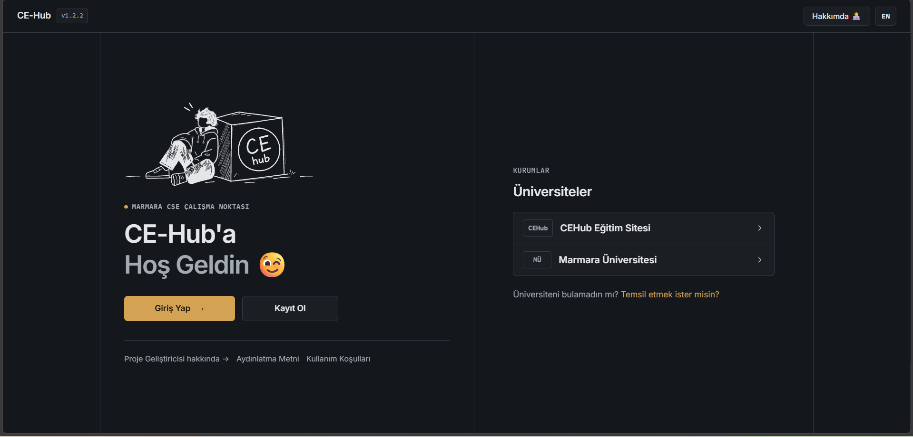 | 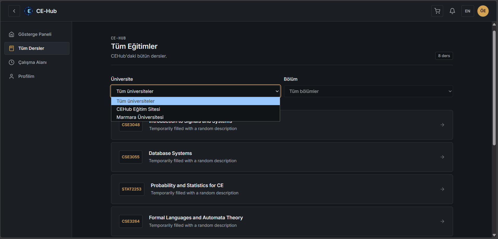 |
| *Ana sayfa: kurumlar herkese açık listeleniyor.* | *Ders listesi: üniversite ve bölüm süzgeci.* |
| 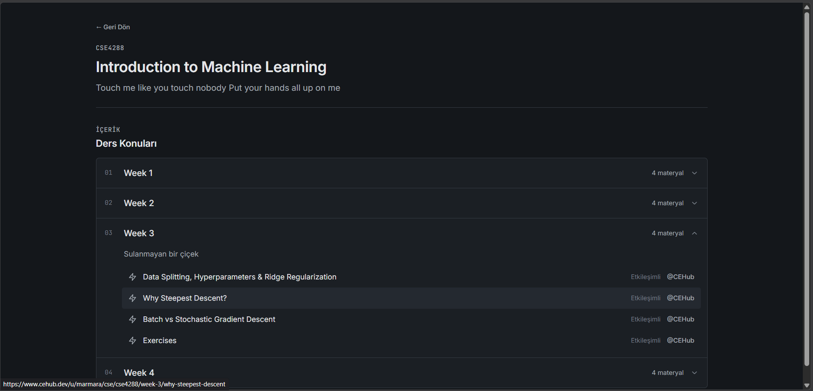 | 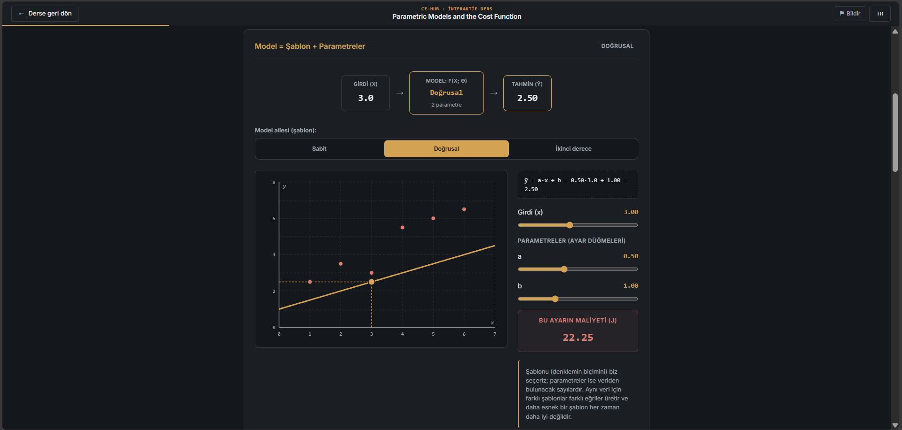 |
| *Ders sayfası: konular, materyaller, yazar etiketi ve okunabilir URL.* | *İnteraktif materyal: model şablonu, parametre kaydırıcıları ve canlı maliyet hesabı.* |
| 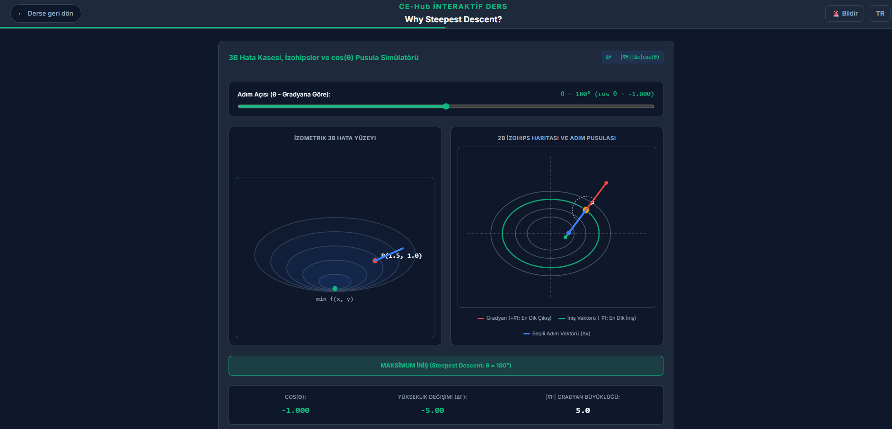 | 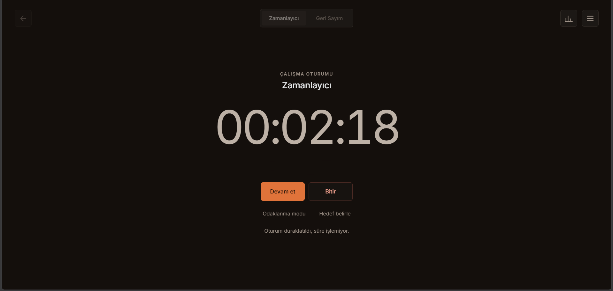 |
| *3B hata yüzeyi ve 2B izohips haritası, adım açısıyla birlikte canlı güncelleniyor.* | *Study Area: sayaç, geri sayım, odaklanma modu ve oturum hedefi.* |
| 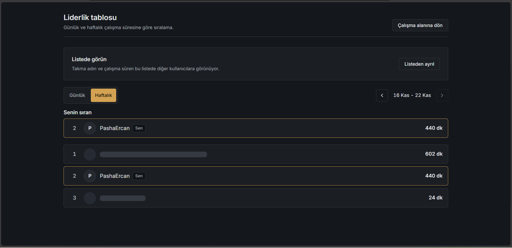 | |
| *Liderlik tablosu: günlük ve haftalık sıralama, katılım isteğe bağlı. Diğer kullanıcıların adları gizlendi.* | |

## İçindekiler

- [Öne çıkanlar](#öne-çıkanlar)
- [Genel mimari](#genel-mimari)
- [Kurum yapısı ve URL'ler](#kurum-yapısı-ve-urller)
- [Ders sistemi](#ders-sistemi)
- [Study Area, CEP ve liderlik tablosu](#study-area-cep-ve-liderlik-tablosu)
- [Roller ve yetki](#roller-ve-yetki)
- [Backend mimarisi](#backend-mimarisi)
- [Kimlik doğrulama ve yasal metinler](#kimlik-doğrulama-ve-yasal-metinler)
- [Frontend mimarisi](#frontend-mimarisi)
- [Kalite ve testler](#kalite-ve-testler)
- [Teknoloji yığını](#teknoloji-yığını)
- [Tasarım kararları](#tasarım-kararları)
- [Büyüme planı: çok üniversiteli yapı](#büyüme-planı-çok-üniversiteli-yapı)
- [Yol haritası](#yol-haritası)
- [Kaynak kod ve iletişim](#kaynak-kod-ve-iletişim)

## Öne çıkanlar

- Birden çok bölümün derslerinden 200'den fazla interaktif materyal. Yenileri eklenmeye devam ediyor.
- Üniversite → Bölüm → Ders → Konu → Materyal yapısı ve okunabilir, paylaşılabilir URL'ler.
- Arayüz ve içerik Türkçe ve İngilizce.
- Study Area: sayaç, geri sayım, çalışma süresine göre CEP puanı, kişisel istatistikler ve isteğe bağlı liderlik tablosu.
- Rol ve izin sistemi: Admin, Moderatör, Content Editor ve üniversiteye bağlı Üniversite Temsilcisi.
- UI kütüphanesi kullanmadan, saf CSS ile kurulmuş tema sistemi: 5 renk paleti, açık ve koyu mod.
- Her materyalde içerik hatası bildirme butonu.
- JWT tabanlı kimlik doğrulama, e-posta doğrulama ve şifre sıfırlama.
- Backend'de 400+, frontend'de 300+ otomatik test.

## Genel mimari

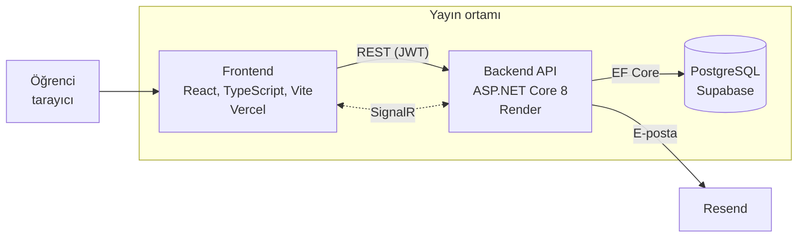

Frontend, backend ve veritabanı ayrı servislerde çalışıyor. SignalR altyapısı gerçek zamanlı özellikler (sohbet ve oyun) için hazırlandı, bu özellikler geliştirme aşamasında. Ücretsiz planda uyuyan API'yi uyandırmak için frontend açılışta bir `health` ucunu yokluyor ve kullanıcıya bekleme ekranı gösteriyor.

## Kurum yapısı ve URL'ler

İçerik tek okul varsayımıyla değil, kurum hiyerarşisiyle tutuluyor. Şu an CEHub'ın kendi kurumu ve Marmara Üniversitesi tanımlı.

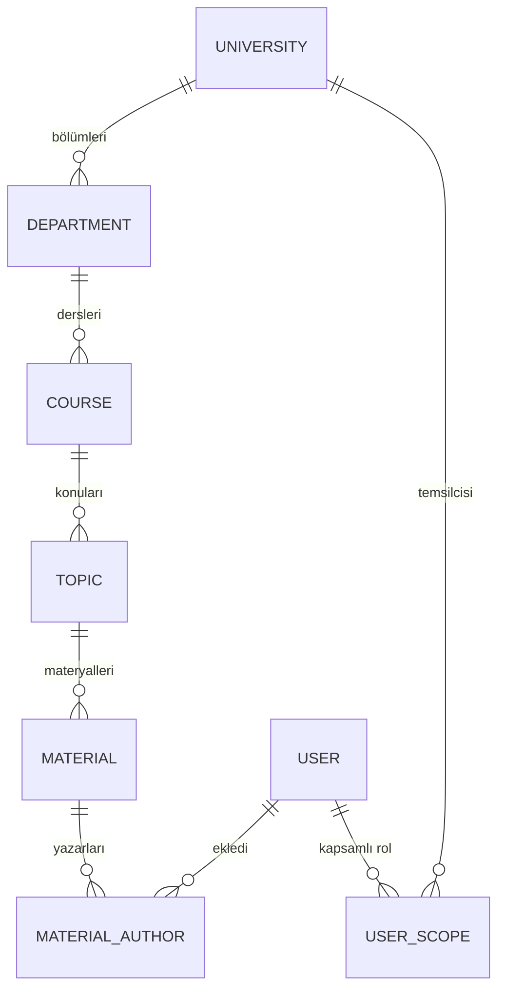

- Yazar kaydı olmayan materyal `@CEHub` olarak, katkıyla eklenen materyal yazarının takma adıyla listeleniyor.
- Kapsamlı roller (ör. bir üniversitenin temsilcisi) kullanıcı tablosunda değil, ayrı bir `UserScope` tablosunda tutuluyor.

### Okunabilir URL'ler

Her seviyenin bir slug'ı var. Örnek:

```text
/u/marmara/cse/cse4288/week-3/why-steepest-descent
   │       │   │       │      └─ materyal
   │       │   │       └─ konu
   │       │   └─ ders
   │       └─ bölüm
   └─ üniversite
```

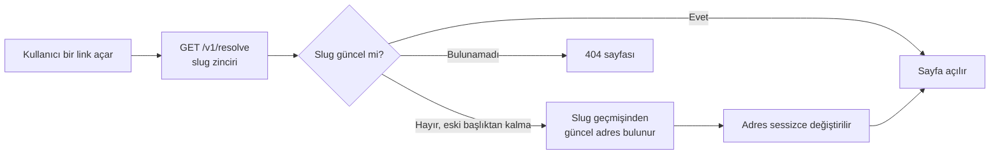

- Kurum ve bölüm sayfaları herkese açık. Ders, konu ve materyal giriş istiyor.
- Konu veya materyal başlığı değişince slug yenileniyor, eskisi geçmişte saklanıyor. Paylaşılmış linkler kırılmıyor.
- Materyalin kimliği Id. Slug yalnızca adres için kullanılıyor.

## Ders sistemi

Platformun ana konusu bu sistem. Bir ders konulardan, bir konu materyallerden oluşuyor. Materyal ya bir **konu anlatımı** ya da bir **alıştırma**.

### Bir materyal nasıl akıyor

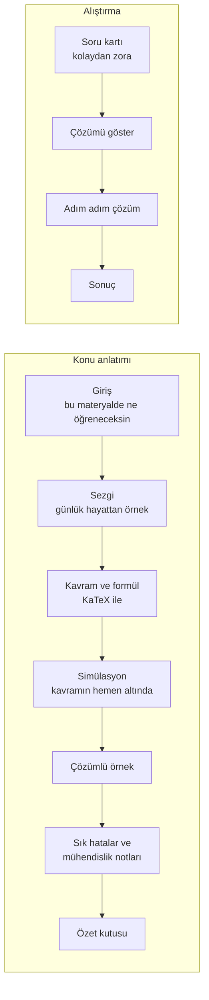

Simülasyon, açıkladığı kavramın hemen altında yer alıyor, sayfanın sonunda toplanmıyor. Önce sezgi, sonra formül geliyor. Her dersin kendi anlatım profili var: akış şablonu, örnek ve notasyon tarzı, simülasyon türleri.

### Materyaller nasıl kayıt oluyor

Yeni bir materyal eklemek için kayıt kodu yazılmıyor. Klasör yapısı ve iki küçük JSON dosyası kaydı kendisi üretiyor.

```text
interactiveLessons/
├── InteractiveRegistry.ts
├── lessonCore.css                     # tüm derslerin ortak stilleri
├── shared/                            # ortak animasyon hook'ları
└── CSE4288_machineLearning/
    ├── course.json                    # { courseCode: "CSE4288", shortCode: "ml" }
    ├── machineLearningCore.css        # derse özel ortak stiller
    └── topic3/
        ├── 2_gradient_geometry_steepest_descent/
        │   ├── meta.json              # { componentId: "ml-t3m2" }
        │   ├── index.tsx              # dile göre içeriği seçer
        │   ├── ContentTR.tsx          # Türkçe içerik
        │   ├── ContentEN.tsx          # İngilizce içerik
        │   ├── Animations.tsx         # simülasyonlar
        │   └── Animations.css         # materyale özel stiller
        └── topic3_exercises_1/
```

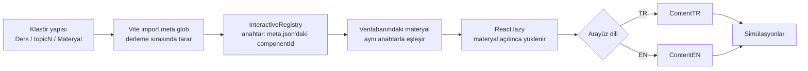

- Bileşen kimliği `{dersKısaKodu}-t{konu}{m|x}{sıra}` biçiminde (`ml-t3m2`: ML, 3. konu, 2. materyal; `x` alıştırma). Klasör adı değişse bile kimlik ve veritabanı eşleşmesi değişmiyor.
- Stiller üç katmanlı: genel (`lessonCore.css`) → ders (`{ders}Core.css`) → materyal. Her materyalin sınıfları kendi kimliğiyle ön ekleniyor, materyaller birbirinin stilini bozmuyor.
- Materyaller açıldıkları anda yüklendiği için, içerik arttıkça ilk yükleme büyümüyor.

### Simülasyonlar

- Her simülasyon tek bir kavrama odaklanıyor, bir materyalde genelde 1 ile 3 tane var.
- Sürekli animasyonlu simülasyonlarda React state'i her karede güncellenmiyor. Hareketli elemanlar `ref` ile tutulup doğrudan DOM üzerinden güncelleniyor.
- Animasyon döngüleri sadece ekranda görünürken ve sekme açıkken çalışıyor.
- `prefers-reduced-motion` ayarı destekleniyor. Geniş içerik (matris, tablo, formül) sayfayı yatay taşırmadan kendi kutusunda kayıyor.
- Ekranda görünen istatistikler gerçek hesaptan çıkıyor, sabit sonuç gösterilmiyor.
- Her materyal 5 paletin açık ve koyu modunda okunur kalacak şekilde yalnızca tema değişkenleriyle renklendiriliyor.

## Study Area, CEP ve liderlik tablosu

Study Area, öğrencilerin sayaç veya geri sayım başlatıp çalıştıkları alan. Oturuma hedef konulabiliyor, odaklanma modu dikkat dağıtan öğeleri gizliyor. Çalışma ortamı (tema) seçilebiliyor.

### Bir çalışma oturumu

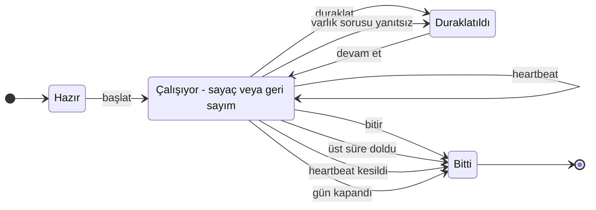

- Tarayıcı belirli aralıklarla heartbeat gönderiyor. Heartbeat kesilen oturum sunucuda kapatılıyor, sekme kapanınca süre işlemeye devam etmiyor.
- Uzun oturumlarda "hâlâ orada mısın?" sorusu çıkıyor. Yanıt gelmezse oturum duraklatılıyor.
- Saatlik ve günlük oturum sınırları, en kısa sayılabilir süre ve gün sonu kapanışı sunucu tarafında uygulanıyor. Tüm süreler UTC tutuluyor.

### CEP puanı

**CEP** (CE-Hub puanı), çalışma süresinden hesaplanıyor.

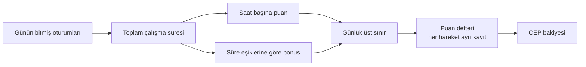

Bakiye tek bir sayı olarak değil, hareket defteri olarak tutuluyor: kazanım, düzeltme ve harcama ayrı satırlar. Böylece her puanın nereden geldiği izlenebiliyor. Kazanılan puanların harcanacağı alan için [yol haritasına](#yol-haritası) bakın.

### Liderlik tablosu

- Katılım isteğe bağlı ve açık rızayla. Rıza kaydı tutuluyor, kullanıcı istediği an listeden ayrılabiliyor.
- Günlük ve haftalık sıralama, önceki dönemlere geri gidilebiliyor.
- Listede yalnızca takma ad ve çalışma süresi görünüyor.
- Katılımcı sayısı belirli bir eşiğin altındaysa tablo gösterilmiyor. Az kişilik listede kimin ne kadar çalıştığı kolayca tahmin edilemesin diye.

## Roller ve yetki

Her kullanıcının tek bir rolü var. Yetkiler role bağlı izinlerden geliyor, kontrol backend'de yapılıyor. Frontend'deki kontroller yalnızca arayüzü düzenlemek için.

| Rol | Kapsam | Ne yapar |
|---|---|---|
| Kullanıcı | Kendi hesabı | Dersleri ve materyalleri kullanır, Study Area'da çalışır, içerik hatası bildirir |
| Content Editor | Genel | İçerik üretir ve materyal yazarı olarak atfedilir |
| Moderatör | Genel | Bildirilen içerik hatalarını inceler ve sonuçlandırır, kullanıcılara bildirim gönderir |
| Üniversite Temsilcisi | **Bir üniversite** | Kendi üniversitesinin derslerini oluşturur ve düzenler, gelen içerikleri denetler |
| Admin | Genel | Platformu yönetir, temsilci atar, tüm süreçleri izler |
| Kurucu Admin | Genel | Admin'in yaptıkları, rol atamaları ve kod deposunda son inceleme |

- Rol hiyerarşisi var: bir yönetici yalnızca kendi seviyesinin altındaki rolleri atayabiliyor.
- Rol düşürme gerekçeyle yapılıyor ve geçmişi kayıt altında tutuluyor.

## Backend mimarisi

Backend, .NET 8 üzerinde Clean Architecture ile katmanlara ayrılmış. Bağımlılık yönü içe doğru: Domain hiçbir katmana bağlı değil.

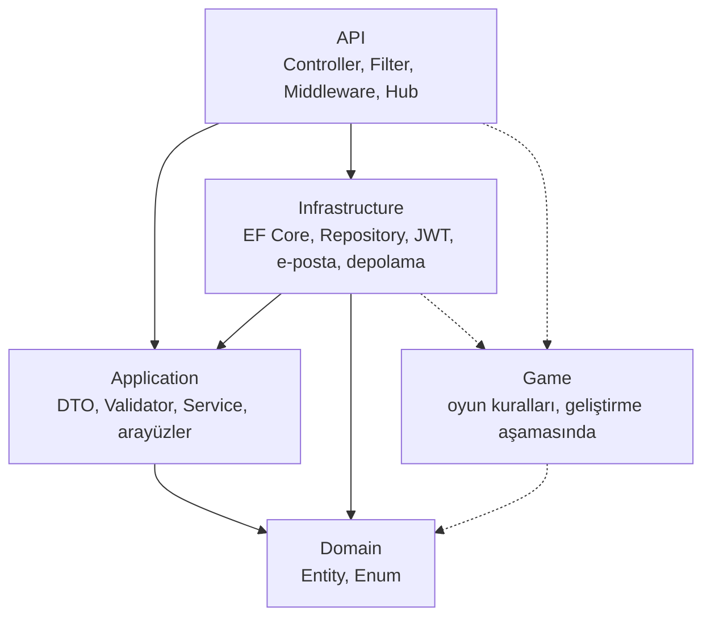

### Klasör yapısı

```text
backend/
├── CEHub.Domain/            # hiçbir katmana bağlı değil
│   ├── Entities/            # University, Department, Course, Topic, Material, User, StudySession...
│   ├── Enums/
│   └── Common/
├── CEHub.Application/       # iş kuralları
│   ├── Authorization/       # izinler, rol hiyerarşisi
│   ├── DTOs/                # modül başına istek/yanıt modelleri
│   ├── Interfaces/          # Repository, Service, UnitOfWork arayüzleri
│   ├── Services/            # modül başına servisler (Courses, StudySessions, Leaderboards...)
│   ├── Options/             # yapılandırma sınıfları ve doğrulamaları
│   └── Exceptions/          # ApiException ve hata kodları
├── CEHub.Infrastructure/    # dış dünya
│   ├── Persistence/         # DbContext, entity yapılandırmaları, migration'lar
│   ├── Repositories/
│   ├── Authentication/      # JWT, token üretimi
│   ├── Services/            # e-posta, ödeme sağlayıcısı
│   └── Storage/             # dosya depolama
├── CEHub.API/               # HTTP katmanı
│   ├── Controllers/         # modül başına ince controller'lar
│   ├── Filters/             # ValidationFilter
│   ├── Middleware/          # hata ve yetki yanıtları
│   └── Hubs/                # SignalR
├── CEHub.Game/              # oyun kuralları, geliştirme aşamasında
└── CEHub.Tests/             # Application ve Infrastructure testleri
```

### Bir isteğin yolu

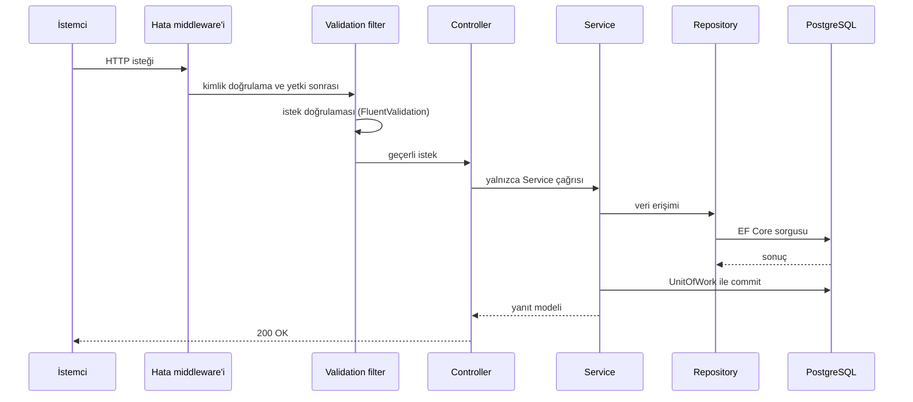

Controller'da iş mantığı yok. İş kuralları Service katmanında, veri erişimi Repository katmanında. Enum değerleri API'de sayı değil, okunabilir metin olarak taşınıyor.

### Hata yönetimi

İş kuralı ihlalleri her yerde aynı biçimde ele alınıyor ve kullanıcıya kendi dilinde ulaşıyor.

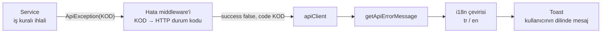

Backend'in ürettiği her hata kodunun frontend'de bir çevirisi var. Çevirisi olmayan kod kullanıcıya ham gösterilmiyor.

## Kimlik doğrulama ve yasal metinler

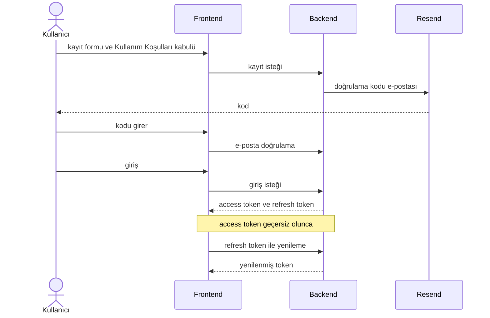

Şifre sıfırlama da aynı yapıda: e-postayla gelen kodla yeni şifre belirleniyor. Girişte e-postası doğrulanmamış kullanıcılar ayrı bir hata koduyla karşılanıyor.

### KVKK (düzenleniyor)

Rıza ve kabul kayıtları sistemde tutuluyor:

- **Kullanım Koşulları kabulü:** kayıtta alınıyor. Metin güncellenince kullanıcı bir sonraki girişte yeni sürümü kabul ediyor.
- **Aydınlatma Metni:** gösterildiği ve okunduğu kaydediliyor.
- **Liderlik tablosu rızası:** açık rıza, geri alınabilir, geçmişi tutuluyor.

Kullanıcı Ayarlar → Gizlilik ekranından rızalarını yönetebiliyor. Metinler şu anda hukuki incelemede. Metin değişince yalnızca sürüm numarası artıyor, kod değişmiyor.

## Frontend mimarisi

Veri akışı tek yönlü ve katmanlı. Sayfalar doğrudan API çağırmıyor.

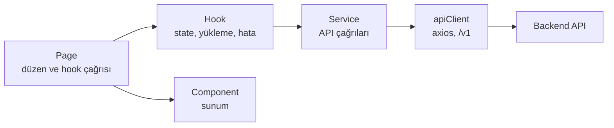

### Klasör yapısı

```text
frontend/src/
├── api/                 # apiClient (axios, hata dönüşümü)
├── components/          # ui, layout, student, admin, legal, notifications...
├── context/             # AuthProvider, ThemeProvider
├── hooks/               # common, student, admin
├── pages/               # public, student, admin, payment
├── routes/              # AppRoutes, yol sabitleri, korumalı rotalar
├── services/            # modül başına API servisleri
├── store/               # zustand store'ları
├── types/               # modül başına tip dosyaları
├── styles/              # theme.css (değişkenler), elements.css, ui.css
├── locales/             # tr/ ve en/ altında namespace başına JSON
├── interactiveLessons/  # ders materyalleri ve registry
├── studyArea/           # kendi pages, components, hooks, services ve çevirileriyle modül
├── author/              # geliştirici sayfası modülü
└── utils/
```

Büyük ve bağımsız alanlar (`studyArea`, `author`) kendi klasöründe, kendi sayfa, bileşen, servis ve çeviri dosyalarıyla duruyor ve ayrı paket olarak lazy yükleniyor.

## Kalite ve testler

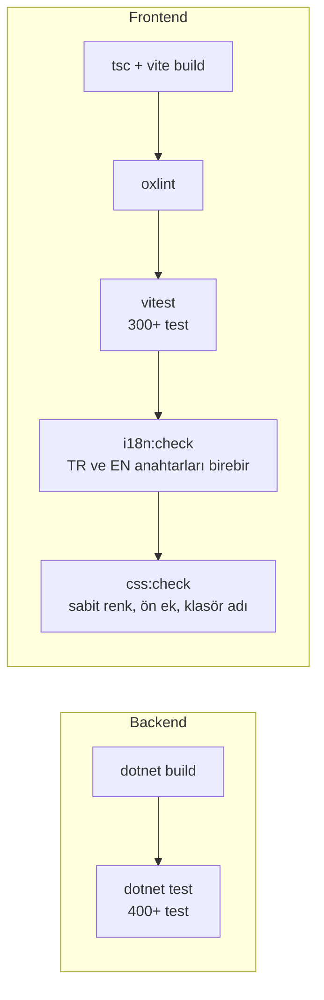

- Backend testleri servis kurallarını, doğrulayıcıları, yetki hiyerarşisini ve puan/oturum değişmezlerini kapsıyor.
- Frontend testleri rota korumalarını, yol sabitlerini, hata çevirisini, registry'yi ve ortak bileşenleri kapsıyor.
- `i18n:check`, iki dilin anahtar kümelerinin aynı olduğunu denetliyor.
- `css:check`, bileşen ve ders CSS'lerinde sabit renk, yanlış sınıf ön eki ve kurala uymayan klasör adı bulunca hata veriyor.

## Teknoloji yığını

| Alan | Teknoloji |
|---|---|
| Frontend | React 19, TypeScript, Vite, react-router, axios, zustand |
| Stil | Saf CSS, tema değişkenleri, 5 palet × açık/koyu mod |
| Çoklu dil | i18next, react-i18next (TR / EN) |
| Matematik | KaTeX |
| Backend | ASP.NET Core (.NET 8, C# 12), Clean Architecture |
| Veri | Entity Framework Core, PostgreSQL |
| Doğrulama ve güvenlik | FluentValidation, JWT (access + refresh) |
| Gerçek zamanlı | SignalR |
| E-posta | Resend |
| Loglama | Serilog |
| Test ve denetim | xUnit, Vitest, Testing Library, oxlint, özel i18n ve CSS denetim betikleri |
| Yayın | Vercel (frontend), Render (API), Supabase (veritabanı) |

## Tasarım kararları

- **UI kütüphanesi yok, saf CSS var.** Tüm renkler CSS değişkenlerinden geliyor, bileşen CSS'inde sabit renk yok. Palet `data-palette`, açık/koyu mod `data-mode` ile değişiyor.
- **Sıfır sabit metin.** Kullanıcıya görünen her metin i18n üzerinden geliyor, TR ve EN anahtar kümeleri birebir aynı tutuluyor.
- **Katmanlı frontend.** Service, Hook, Page, Component sırası sabit. Sayfalarda servis çağrısı yapılmıyor.
- **İnce controller.** İş mantığı Service'te, hatalar tek tip `ApiException` koduyla taşınıyor.
- **Normalize veri.** Kopya alan tutulmuyor, değer ilişkiden türetiliyor. Rol kapsamı ve yazarlık ayrı tablolarda.
- **Zaman UTC.** Backend her yerde UTC ile çalışıyor, tarihler kullanıcının yerel saatinde ve diline göre biçimlendirilerek gösteriliyor.
- **Klasörden kayıt.** Ders materyalleri klasör yapısından otomatik bulunuyor, içerik eklemek kayıt kodu gerektirmiyor.
- **Erişilebilirlik.** Klavye odağı görünür kalıyor, ikon butonlarında etiket var, hareket azaltma tercihi destekleniyor.

## Büyüme planı: çok üniversiteli yapı

CE-Hub'ın hedefi tek bir bölümün ders sitesi olmak değil. Farklı üniversitelerden içerik üreticileri ve üniversite temsilcileriyle büyüyen bir platform olmak.

**Bugün kurulu olanlar:**

- Üniversite → Bölüm → Ders hiyerarşisi ve slug'lı URL'ler canlıda.
- Kurum ve bölüm sayfaları herkese açık. Listede olmayan üniversite için "Temsil etmek ister misin?" girişi var.
- Üniversite Temsilcisi rolü ve üniversite kapsamlı yetki kontrolü kodda hazır.
- Materyal yazarlığı ayrı tabloda tutuluyor ve ders sayfasında gösteriliyor.

**Planlanan katkı ve yayın akışı:**

Dışarıdan içerik dosya olarak değil, bir formla geliyor. Kod deposuna giren her şey otomatik kontrollerden ve insan incelemesinden geçiyor.

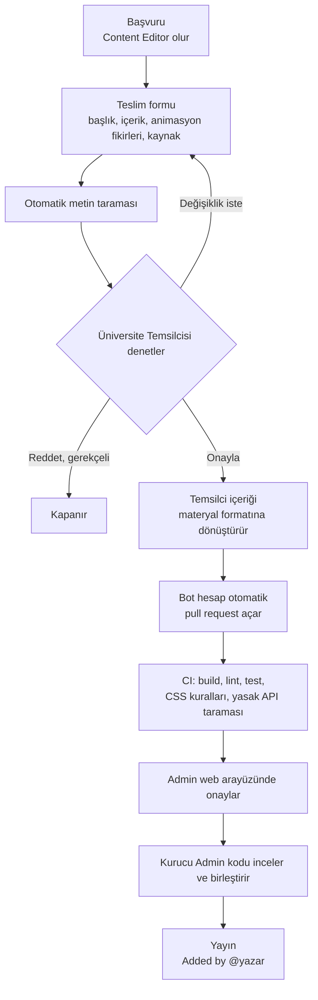

- Temsilcisi olmayan üniversitelerden gelen içerikleri Admin denetliyor.
- Temsilcilere kod deposu erişimi verilmiyor, dosyalar web arayüzünden yükleniyor.
- İçerik üreten ile denetleyen aynı kişi değil.

## Yol haritası

```mermaid
flowchart LR
    subgraph Canli["Canlı"]
        L1["İnteraktif ders sistemi"]
        L2["Kurum yapısı ve slug'lı URL'ler"]
        L3["Kimlik doğrulama, roller ve yetki"]
        L4["Study Area, CEP ve liderlik tablosu"]
    end
    subgraph Duzenleniyor["Düzenleniyor"]
        D1["KVKK metinleri<br/>hukuki inceleme"]
        D2["Ödeme altyapısı"]
    end
    subgraph Gelistirme["Geliştirme aşamasında"]
        G1["Hu(B)ahçe<br/>sohbet ve kişisel bahçe"]
        G2["Oyun katmanı"]
    end
    subgraph Planlanan["Planlanan"]
        P1["Katkı ve yayın akışı<br/>Content Editor ve Temsilci"]
        P2["Üniversite talebi ve<br/>temsilci başvurusu"]
        P3["CI ve TypeScript strict mod"]
        P4["Çıkmış sorular ve<br/>mini tutorial'lar"]
    end
    Canli --> Duzenleniyor
    Duzenleniyor --> Gelistirme
    Gelistirme --> Planlanan
```

- **KVKK ve ödeme:** Rıza kayıtları canlıda, metinler hukuki incelemede. Ödeme altyapısı kodda hazır, uçtan uca bağlantısı tamamlanıyor.
- **Hu(B)ahçe:** Üniversiteye yeni başlayanların ve kulüplerin kendi aralarında rahatça sohbet edebileceği bir alan. Kazanılan CEP'in harcandığı, eşyaların alındığı ve bitkilerin yetiştirildiği kişisel bir bahçe fikri de bunun parçası. Kapsam henüz netleşiyor.
- **Oyun katmanı:** Gerçek zamanlı, SignalR üzerinden çalışan bir oyun için altyapı hazırlanıyor. Kuralları yeniden tasarlanıyor.
- **Katkı akışı:** Yukarıdaki [büyüme planındaki](#büyüme-planı-çok-üniversiteli-yapı) form, denetim ve otomatik yayın hattı.
- **TypeScript strict mod:** Kod tabanı şu an strict modda değil. CI kurulumuyla birlikte strict moda geçiş planlanıyor.
- **Çıkmış sorular ve mini tutorial'lar:** Okulda kullanılan yazılımlar için kısa anlatımlar. Henüz plan aşamasında.

## Kaynak kod ve iletişim

CE-Hub'ın kaynak kodu private. Bu repo yalnızca tanıtım amaçlıdır ve kaynak kod içermez. Mimariyi ve kodu görüşmede gösterebilirim.

**Ömer Ercan Dayan**, Marmara Üniversitesi Bilgisayar Mühendisliği

- GitHub: [ErcanPasha](https://github.com/ErcanPasha)
- LinkedIn: [Ömer Ercan Dayan](https://www.linkedin.com/in/%C3%B6mer-ercan-dayan-041124256/)
- E-posta: dayanomerercan@gmail.com
- Canlı proje: [cehub.dev](https://cehub.dev)

Tüm hakları saklıdır.
