# CE-Hub

Marmara Üniversitesi mühendislik öğrencileri için interaktif ders ve çalışma platformu.

**Canlı:** [cehub.dev](https://cehub.dev) &nbsp;|&nbsp; **Durum:** canlıda, aktif geliştirme &nbsp;|&nbsp; **Kaynak kod:** private

CE-Hub, mühendislik derslerini sadece okumak yerine denemeyi öne alan bir platform. Formülün yanında kaydırıcıyla oynanabilen simülasyonlar, çözümlü örnekler ve alıştırmalar var. Tasarımı, frontend'i, backend'i ve yayın sürecini ben yürütüyorum. Platform 200'den fazla öğrenciye açık, yeni ders ve içerikler eklenmeye devam ediyor.

> Platform giriş gerektirir. Demo hesap için bana ulaşabilirsiniz (iletişim bilgileri en altta).

## Ekran görüntüleri

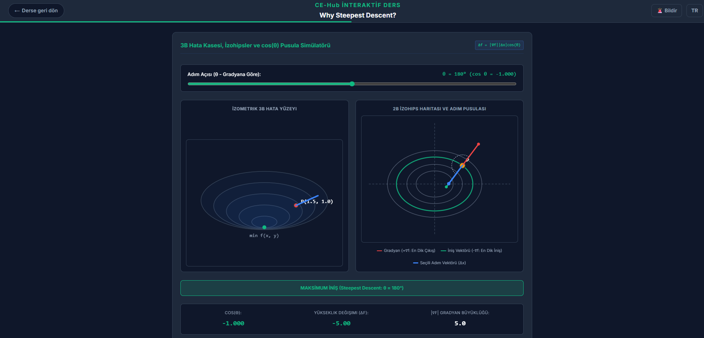

*Makine Öğrenmesi dersinden bir interaktif materyal: 3B hata yüzeyi ve 2B izohips haritası, adım açısı kaydırıcısıyla birlikte canlı güncelleniyor.*

<!-- TODO: Study Area güncellemesi bitince ekle


*Study Area: sayaç, geri sayım, CEP puanı ve istatistikler.*
-->

<!-- TODO: Ders portalı ekran görüntüsü ekle


*Ders ve konu listesi.*
-->

## İçindekiler

- [Öne çıkanlar](#öne-çıkanlar)
- [Genel mimari](#genel-mimari)
- [Ders sistemi](#ders-sistemi)
- [Study Area ve CEP](#study-area-ve-cep)
- [Backend mimarisi](#backend-mimarisi)
- [Kimlik doğrulama](#kimlik-doğrulama)
- [Frontend mimarisi](#frontend-mimarisi)
- [Teknoloji yığını](#teknoloji-yığını)
- [Tasarım kararları](#tasarım-kararları)
- [Yol haritası](#yol-haritası)
- [Kaynak kod ve iletişim](#kaynak-kod-ve-iletişim)

## Öne çıkanlar

- 6 ders, yaklaşık 190 interaktif materyal. Hepsi canlıda, yenileri eklenmeye devam ediyor.
- Arayüz ve içerik Türkçe ve İngilizce.
- Study Area: sayaç, geri sayım, çalışma süresine oranla CEP puanı, kişisel istatistikler ve opsiyonel genel liderlik tablosu.
- UI kütüphanesi kullanmadan, saf CSS ile kurulmuş 6 temalı tasarım sistemi.
- Her materyalde içerik hatası bildirme butonu.
- JWT tabanlı kimlik doğrulama, e-posta doğrulama ve şifre sıfırlama.
- Responsive arayüz.

## Genel mimari

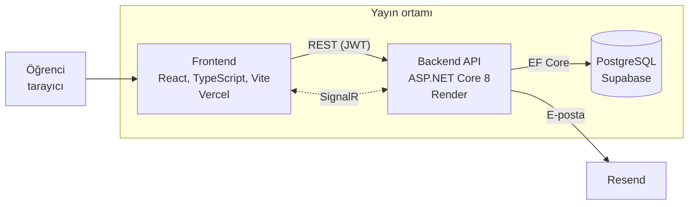

Frontend, backend ve veritabanı ayrı servislerde çalışıyor. SignalR altyapısı gerçek zamanlı özellikler (sohbet ve oyun) için hazırlandı, bu özellikler geliştirme aşamasında.

## Ders sistemi

Platformun ana konusu bu sistem. Bir ders, konulardan; bir konu, materyallerden oluşuyor. Materyal ya bir **konu anlatımı** ya da bir **alıştırma**.

### Bir materyal nasıl akıyor

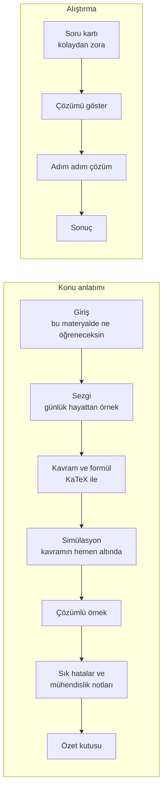

Simülasyon, açıkladığı kavramın hemen altında yer alıyor, sayfanın sonunda toplanmıyor. Önce sezgi, sonra formül geliyor.

### Materyaller nasıl kayıt oluyor

Yeni bir materyal eklemek için kayıt kodu yazılmıyor. Klasör yapısı kaydı kendisi üretiyor.

```text
interactiveLessons/
├── InteractiveRegistry.ts
├── lessonCore.css
└── CSE4288_machineLearning/
    └── topic4/
        └── 2_minibatch_sgd_epochs/
            ├── index.tsx        # dile göre içeriği seçer
            ├── ContentTR.tsx    # Türkçe içerik
            ├── ContentEN.tsx    # İngilizce içerik
            ├── Animations.tsx   # simülasyonlar
            └── Animations.css   # materyale özel stiller
```

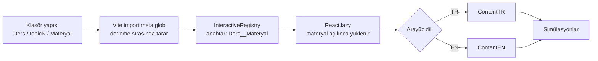

Materyaller açıldıkları anda yüklendiği için, içerik arttıkça ilk yükleme büyümüyor.

### Simülasyonlar

- Her simülasyon tek bir kavrama odaklanıyor, bir materyalde genelde 1 ile 3 tane var.
- Sürekli animasyonlu simülasyonlarda React state'i her karede güncellenmiyor. Hareketli elemanlar `ref` ile tutulup doğrudan DOM üzerinden güncelleniyor.
- Animasyon döngüleri sadece ekranda görünürken ve sekme açıkken çalışıyor.
- `prefers-reduced-motion` ayarı destekleniyor, geniş içerik (matris, tablo, formül) sayfayı yatay taşırmadan kendi kutusunda kayıyor.
- Ekranda görünen istatistikler gerçek hesaptan çıkıyor, sabit sonuç gösterilmiyor.

### Dersler

| Ders | Konu |
|---|---|
| CSE2023 | Ayrık Matematik |
| CSE3048 | Sinyaller |
| CSE3055 | Veritabanı Sistemleri |
| CSE3264 | Otomata |
| CSE4288 | Makine Öğrenmesi |
| STAT2253 | İstatistik |

## Study Area ve CEP

Study Area, öğrencilerin sayaç veya geri sayım başlatıp çalıştıkları alan. Çalışma süresine oranla **CEP** (CE-Hub puanı) kazanılıyor. Kişisel istatistikler görülebiliyor, isteyenler genel liderlik tablosuna katılabiliyor. Bu bölüm şu anda güncelleniyor.

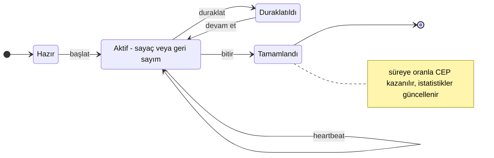

CEP bakiyesi ve hareket geçmişi kayıt altında tutuluyor. Kazanılan puanların harcanacağı alan için [yol haritasına](#yol-haritası) bakın.

## Backend mimarisi

Backend, .NET 8 üzerinde Clean Architecture ile katmanlara ayrılmış. Bağımlılık yönü içe doğru: Domain hiçbir katmana bağlı değil.

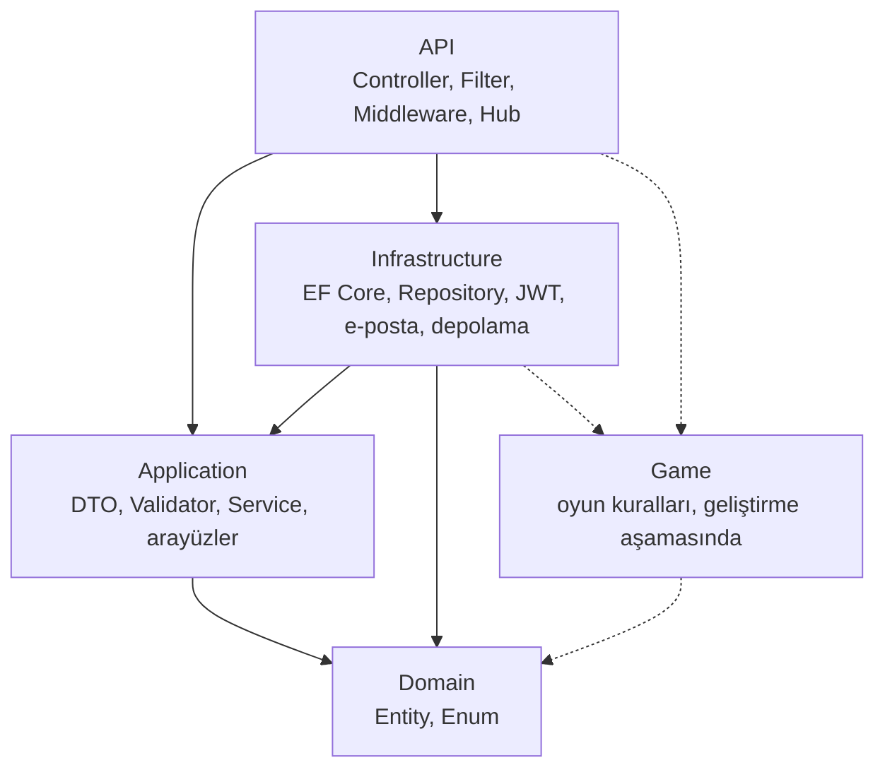

### Bir isteğin yolu

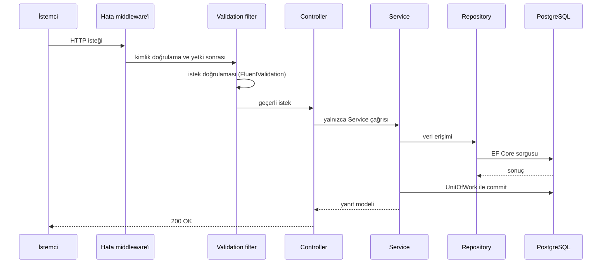

Controller'da iş mantığı yok. İş kuralları Service katmanında, veri erişimi Repository katmanında.

### Hata yönetimi

İş kuralı ihlalleri her yerde aynı biçimde ele alınıyor ve kullanıcıya kendi dilinde ulaşıyor.

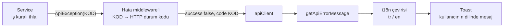

Backend'in ürettiği her hata kodunun frontend'de bir çevirisi var. Çevirisi olmayan kod kullanıcıya ham gösterilmiyor.

## Kimlik doğrulama

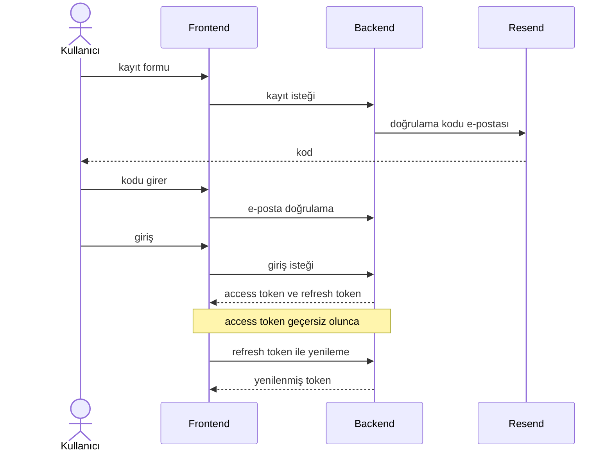

Şifre sıfırlama da aynı yapıda: e-postayla gelen kodla yeni şifre belirleniyor. Girişte e-postası doğrulanmamış kullanıcılar ayrı bir hata koduyla karşılanıyor.

## Frontend mimarisi

Veri akışı tek yönlü ve katmanlı. Sayfalar doğrudan API çağırmıyor.

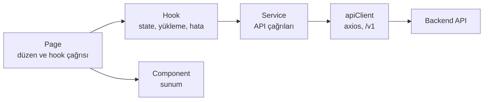

```text
src/
├── api/                 apiClient
├── components/          ui, layout, student/{modül}, admin/{modül}
├── context/             AuthProvider, ThemeProvider
├── hooks/               common, student, admin
├── interactiveLessons/  ders materyalleri ve registry
├── locales/             tr.json, en.json
├── pages/               public, student, admin
├── routes/              AppRoutes, korumalı rotalar
├── services/            API servisleri
├── store/               zustand store'ları
├── types/               modül başına tip dosyası
└── utils/
```

## Teknoloji yığını

| Alan | Teknoloji |
|---|---|
| Frontend | React 19, TypeScript (strict), Vite, react-router, axios, zustand |
| Stil | Saf CSS, tema değişkenleri, 6 tema |
| Çoklu dil | i18next, react-i18next (TR / EN) |
| Matematik | KaTeX |
| Backend | ASP.NET Core (.NET 8, C# 12), Clean Architecture |
| Veri | Entity Framework Core, PostgreSQL |
| Doğrulama ve güvenlik | FluentValidation, JWT (access + refresh) |
| Gerçek zamanlı | SignalR |
| E-posta | Resend |
| Loglama | Serilog |
| Yayın | Vercel (frontend), Render (API), Supabase (veritabanı) |

## Tasarım kararları

- **UI kütüphanesi yok, saf CSS var.** Tüm renkler CSS değişkenlerinden geliyor, bileşen CSS'inde sabit renk yok. 6 tema `data-theme` ile değişiyor.
- **Sıfır sabit metin.** Kullanıcıya görünen her metin i18n üzerinden geliyor, `tr.json` ve `en.json` anahtar kümeleri birebir aynı tutuluyor.
- **Katmanlı frontend.** Service, Hook, Page, Component sırası sabit. Sayfalarda servis çağrısı yapılmıyor.
- **İnce controller.** İş mantığı Service'te, hatalar tek tip `ApiException` koduyla taşınıyor.
- **Zaman UTC.** Backend her yerde UTC ile çalışıyor, tarihler kullanıcının yerel saatinde ve diline göre biçimlendirilerek gösteriliyor.
- **Klasörden kayıt.** Ders materyalleri klasör yapısından otomatik bulunuyor, bu yüzden içerik eklemek kod değişikliği gerektirmiyor.
- **Erişilebilirlik.** Klavye odağı görünür kalıyor, ikon butonlarında etiket var, hareket azaltma tercihi destekleniyor.

## Yol haritası

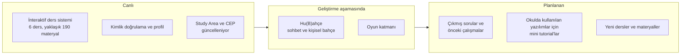

- **Hu(B)ahçe:** Üniversiteye yeni başlayanların ve kulüplerin kendi aralarında rahatça sohbet edebileceği bir alan. Kazanılan CEP'in harcandığı, eşyaların alındığı ve bitkilerin yetiştirildiği kişisel bir bahçe fikri de bunun parçası. Kapsam henüz netleşiyor.
- **Oyun katmanı:** Gerçek zamanlı, SignalR üzerinden çalışan bir oyun için altyapı hazırlanıyor. Kuralları yeniden tasarlanıyor.
- **Çıkmış sorular ve mini tutorial'lar:** Henüz plan aşamasında.

## Kaynak kod ve iletişim

CE-Hub'ın kaynak kodu private. Bu repo yalnızca tanıtım amaçlıdır ve kaynak kod içermez. Mimariyi ve kodu görüşmede gösterebilirim.

**Ömer Ercan Dayan**, Marmara Üniversitesi Bilgisayar Mühendisliği

- GitHub: [ErcahPasha](https://github.com/ErcahPasha)
- LinkedIn: [Ömer Ercan Dayan](https://www.linkedin.com/in/%C3%B6mer-ercan-dayan-041124256/)
- E-posta: dayanomerercan@gmail.com
- Canlı proje: [cehub.dev](https://cehub.dev)

Tüm hakları saklıdır.
